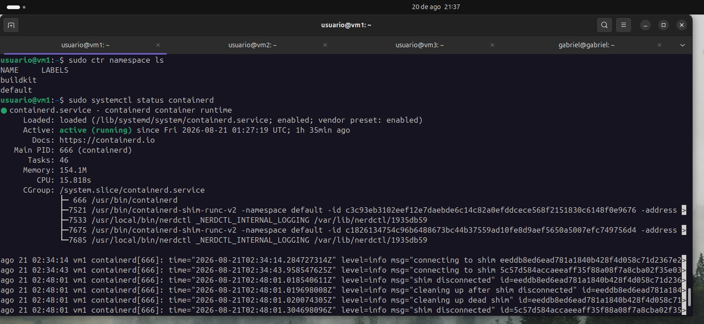
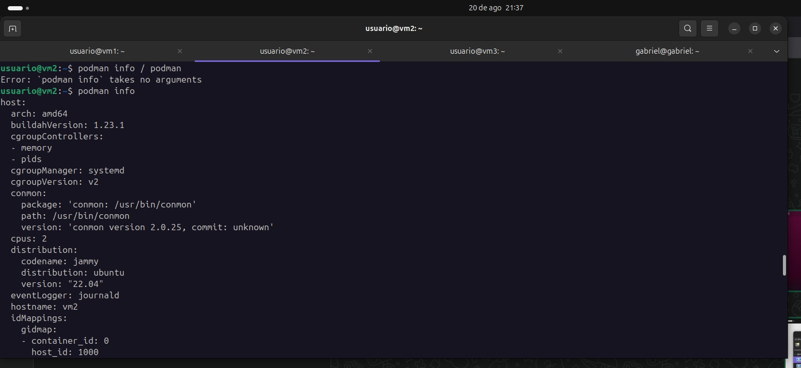
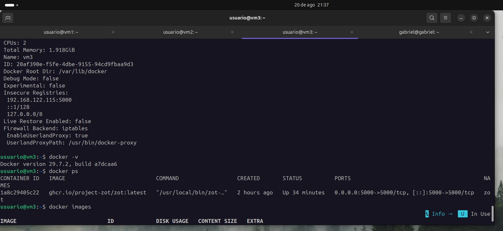
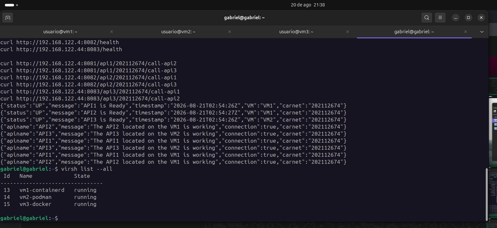

# Manual Técnico
### Desarrollo, Conexión y Gestión de Contenedores en Entornos Virtualizados

Alvaro Gabriel Ramirez Alvarez
Carnet: 202112674 

---

## Índice

1. [Introducción](#1-introducción)
2. [Arquitectura del sistema](#2-arquitectura-del-sistema)
3. [Preparación del entorno (host)](#3-preparación-del-entorno-host)
4. [VM1 — containerd, API1 y API2](#4-vm1--containerd-api1-y-api2)
5. [VM2 — Podman y API3](#5-vm2--podman-y-api3)
6. [VM3 — Docker y registro Zot](#6-vm3--docker-y-registro-zot)
7. [Registro de imágenes y comunicación cruzada](#7-registro-de-imágenes-y-comunicación-cruzada)
8. [Incidencias encontradas y solución aplicada](#8-incidencias-encontradas-y-solución-aplicada)
9. [Pruebas de funcionamiento y evidencia](#9-pruebas-de-funcionamiento-y-evidencia)
10. [Repositorio de código](#10-repositorio-de-código)
11. [Conclusiones](#11-conclusiones)

---

## 1. Introducción

Este manual documenta el diseño, la implementación y las pruebas realizadas para el Proyecto 1 del curso de Sistemas Operativos 1. El proyecto consiste en un entorno virtualizado compuesto por tres máquinas virtuales gestionadas con KVM, cada una ejecutando un runtime de contenedores distinto (containerd, Podman y Docker), tres APIs REST desarrolladas en Go que se comunican entre sí, y un registro privado de imágenes (Zot) para la distribución de las mismas.

---

## 2. Arquitectura del sistema

El entorno está compuesto por un host Linux con virtualización KVM activada, sobre el cual corren tres máquinas virtuales. Cada una cumple un rol específico dentro de la arquitectura:

| Máquina Virtual | Runtime | Contenedor(es) | IP asignada |
|---|---|---|---|
| VM1 | containerd (nerdctl) | api1, api2 | 192.168.122.4 |
| VM2 | Podman | api3 | 192.168.122.44 |
| VM3 | Docker | Zot (registro) | 192.168.122.115 |

Flujo general: API1 y API2 corren en VM1 sobre containerd; API3 corre en VM2 sobre Podman. Las tres APIs exponen un endpoint /health y endpoints de llamada cruzada que verifican, vía HTTP/REST, el estado de las otras APIs. Las imágenes de contenedor de las tres APIs se construyen localmente en su VM correspondiente, se suben (push) al registro Zot alojado en VM3 sobre Docker, y desde ahí se descargan (pull) para su despliegue.

| Servicio | VM | Puerto | URL de salud |
|---|---|---|---|
| API1 | VM1 | 8081 | http://192.168.122.4:8081/health |
| API2 | VM1 | 8082 | http://192.168.122.4:8082/health |
| API3 | VM2 | 8083 | http://192.168.122.44:8083/health |
| Zot | VM3 | 5000 | http://192.168.122.115:5000/v2/_catalog |

---

## 3. Preparación del entorno (host)

### 3.1 Verificación de soporte de virtualización

```bash
egrep -c '(vmx|svm)' /proc/cpuinfo
kvm-ok
```

### 3.2 Instalación de KVM/QEMU y libvirt

```bash
sudo apt update
sudo apt install -y qemu-kvm libvirt-daemon-system libvirt-clients bridge-utils virtinst virt-manager
sudo usermod -aG libvirt,kvm $USER
```


## 4. VM1 — containerd, API1 y API2

### 4.1 Instalación de containerd y herramientas

```bash
sudo apt update
sudo apt install -y containerd
sudo systemctl enable --now containerd

# nerdctl (CLI tipo Docker para containerd)
wget https://github.com/containerd/nerdctl/releases/download/v1.7.6/nerdctl-1.7.6-linux-amd64.tar.gz
sudo tar Cxzvvf /usr/local/bin nerdctl-1.7.6-linux-amd64.tar.gz

# Plugins CNI para red de contenedores
sudo mkdir -p /opt/cni/bin
wget https://github.com/containernetworking/plugins/releases/download/v1.5.1/cni-plugins-linux-amd64-v1.5.1.tgz
sudo tar Cxzvvf /opt/cni/bin cni-plugins-linux-amd64-v1.5.1.tgz
```

### 4.2 Instalación de Go

```bash
wget https://go.dev/dl/go1.22.5.linux-amd64.tar.gz
sudo tar -C /usr/local -xzf go1.22.5.linux-amd64.tar.gz
echo 'export PATH=$PATH:/usr/local/go/bin' >> ~/.bashrc
source ~/.bashrc
```

### 4.3 Desarrollo de API1 y API2

Ambas APIs se desarrollaron en Go usando únicamente el paquete estándar net/http. Cada una expone:


Estructura de respuesta implementada para `/health`:
```json
{
  "status": "UP",
  "message": "API1 is Ready",
  "timestamp": "2026-08-21T02:41:04Z",
  "VM": "VM1",
  "carnet": "202112674"
}
```

Estructura de respuesta implementada para los endpoints `call-apiX`:
```json
{
  "apiname": "API2",
  "message": "The API2 located on the VM1 is working",
  "connection": true,
  "carnet": "202112674"
}
```


### 4.4 Empaquetado en contenedores (Dockerfile)

```dockerfile
FROM golang:1.22-alpine AS build
WORKDIR /app
COPY . .
RUN go mod tidy && go build -o server main.go

FROM alpine:latest
WORKDIR /app
COPY --from=build /app/server .
EXPOSE 8081
CMD ["./server"]
```

### 4.5 Construcción de imágenes

```bash
cd ~/api1
sudo nerdctl build -t api1-202112674:v1 .

cd ~/api2
sudo nerdctl build -t api2-202112674:v1 .
```

---

## 5. VM2 — Podman y API3

### 5.1 Instalación de Podman y Go

```bash
sudo apt update
sudo apt install -y podman

wget https://go.dev/dl/go1.22.5.linux-amd64.tar.gz
sudo tar -C /usr/local -xzf go1.22.5.linux-amd64.tar.gz
echo 'export PATH=$PATH:/usr/local/go/bin' >> ~/.bashrc
source ~/.bashrc
```


### 5.2 Construcción de la imagen

```bash
cd ~/api3
sudo podman build -t api3-202112674:v1 .
```

---

## 6. VM3 — Docker y registro Zot

### 6.1 Instalación de Docker

```bash
curl -fsSL https://get.docker.com | sudo sh
sudo usermod -aG docker $USER
```

### 6.2 Configuración y despliegue de Zot

Archivo de configuración (`~/zot/config.json`):
```json
{
  "distSpecVersion": "1.1.0",
  "storage": { "rootDirectory": "/var/lib/registry" },
  "http": { "address": "0.0.0.0", "port": "5000" },
  "log": { "level": "debug" }
}
```

Despliegue del contenedor (con política de reinicio automático para tolerar reinicios de la VM):
```bash
docker run -d -p 5000:5000 \
  -v $(pwd)/config.json:/etc/zot/config.json \
  -v zot-data:/var/lib/registry \
  --restart unless-stopped \
  --name zot ghcr.io/project-zot/zot:latest
```

Verificación:
```bash
curl http://localhost:5000/v2/_catalog
```

---

## 7. Registro de imágenes y comunicación cruzada

### 7.1 Configuración de registros inseguros (HTTP, sin certificado)

Dado que el registro Zot no cuenta con certificado HTTPS en este entorno de laboratorio, fue necesario indicarle a cada runtime que lo tratara como registro inseguro.

**containerd / nerdctl (VM1):**
```bash
sudo nerdctl --insecure-registry push 192.168.122.115:5000/api1-202112674:v1
```

**Podman (VM2) — `/etc/containers/registries.conf`:**
```toml
[[registry]]
location = "192.168.122.115:5000"
insecure = true
```

**Docker (VM3) — `/etc/docker/daemon.json`:**
```json
{ "insecure-registries": ["192.168.122.115:5000"] }
```

### 7.2 Publicación (push) de imágenes

```bash
# API1 y API2, desde VM1
sudo nerdctl tag <ID_IMAGEN> 192.168.122.115:5000/api1-202112674:v1
sudo nerdctl --insecure-registry push 192.168.122.115:5000/api1-202112674:v1

# API3, desde VM2
sudo podman tag api3-202112674:v1 192.168.122.115:5000/api3-202112674:v1
sudo podman push 192.168.122.115:5000/api3-202112674:v1
```

### 7.3 Descarga (pull) y despliegue

```bash
# En VM1
sudo nerdctl --insecure-registry pull 192.168.122.115:5000/api1-202112674:v1
sudo nerdctl run -d -p 8081:8081 --name api1 192.168.122.115:5000/api1-202112674:v1

sudo nerdctl --insecure-registry pull 192.168.122.115:5000/api2-202112674:v1
sudo nerdctl run -d -p 8082:8082 --name api2 192.168.122.115:5000/api2-202112674:v1

# En VM2
sudo podman pull 192.168.122.115:5000/api3-202112674:v1
sudo podman run -d -p 8083:8083 --name api3 192.168.122.115:5000/api3-202112674:v1
```


## 8. Pruebas de funcionamiento y evidencia

### 8.1 Verificación individual de salud 

```bash
curl http://192.168.122.4:8081/health
curl http://192.168.122.4:8082/health
curl http://192.168.122.44:8083/health
```

### 8.2 Comunicación cruzada entre APIs

```bash
curl http://192.168.122.4:8081/api1/202112674/call-api2
curl http://192.168.122.4:8081/api1/202112674/call-api3
curl http://192.168.122.4:8082/api2/202112674/call-api1
curl http://192.168.122.4:8082/api2/202112674/call-api3
curl http://192.168.122.44:8083/api3/202112674/call-api1
curl http://192.168.122.44:8083/api3/202112674/call-api2
```

Resultado esperado (ejemplo real obtenido en pruebas):
```json
{"apiname":"API2","message":"The API2 located on the VM1 is working","connection":true,"carnet":"202112674"}
{"apiname":"API1","message":"The API1 located on the VM1 is working","connection":true,"carnet":"202112674"}
{"apiname":"API3","message":"The API3 located on the VM2 is working","connection":true,"carnet":"202112674"}
```


### 8.4 Capturas










---
