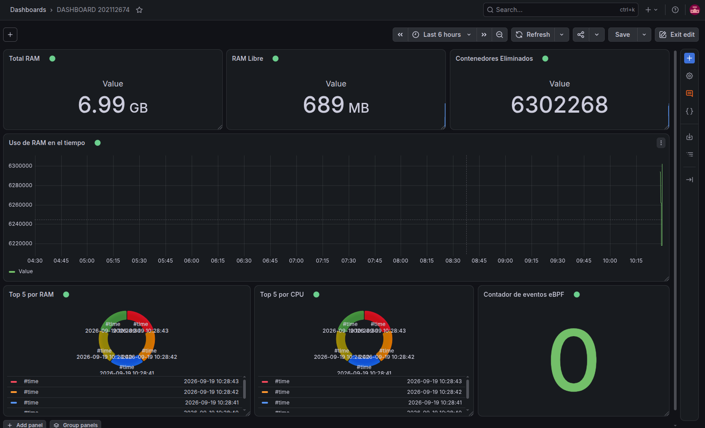

# Manual Técnico
### Proyecto 2  Sonda de Kernel en C y Daemon en Go para la Telemetría de Contenedores

Alvaro Gabriel Ramirez Alvarez: 202112674 

---

## Índice

1. [Introducción](#1-introducción)
2. [Arquitectura del sistema](#2-arquitectura-del-sistema)
3. [Preparación del entorno (host)](#3-preparación-del-entorno-host)
4. [Módulo de kernel (C)](#4-módulo-de-kernel-c)
5. [Cronjob y carga de trabajo](#5-cronjob-y-carga-de-trabajo)
6. [Observabilidad con eBPF](#6-observabilidad-con-ebpf)
7. [Daemon en Go](#7-daemon-en-go)
8. [Persistencia en Valkey](#8-persistencia-en-valkey)
9. [Dashboard de Grafana](#9-dashboard-de-grafana)
10. [Incidencias encontradas y solución aplicada](#10-incidencias-encontradas-y-solución-aplicada)
11. [Pruebas de funcionamiento](#11-pruebas-de-funcionamiento)
12. [Repositorio de código](#12-repositorio-de-código)
13. [Conclusiones](#13-conclusiones)

---

## 1. Introducción

Este manual documenta el diseño, implementación y pruebas del Proyecto 2 del curso de Sistemas Operativos 1: un sistema integral de telemetría y gestión autónoma de contenedores, compuesto por un módulo de kernel en C, un programa de observabilidad eBPF, un daemon orquestador en Go, un cronjob generador de carga, una base de datos Valkey y un dashboard en Grafana.

---

## 2. Arquitectura del sistema

El sistema combina programación de bajo nivel (kernel, eBPF) con un componente de alto nivel en Go que actúa como cerebro del sistema.

| Componente | Tecnología | Función |
|---|---|---|
| Módulo de kernel | C (kernel module) | Expone RAM y procesos de contenedores en `/proc` |
| Cronjob | Bash + cron | Despliega 5+1 contenedores de prueba cada 2 min |
| Programa eBPF | C + cilium/ebpf (Go) | Audita llamadas `sys_kill` / tracepoint |
| Daemon | Go | Orquesta todo, gestiona contenedores, persiste en Valkey |
| Base de datos | Valkey (compatible Redis) | Almacena snapshots, top 5, eventos eBPF |
| Visualización | Grafana + plugin redis-datasource | Dashboard con métricas en tiempo real |

**Flujo general:** al iniciar, el Daemon levanta Grafana y Valkey (docker compose), instala el cronjob de generación de carga, compila y carga el módulo de kernel, y adjunta el programa eBPF al tracepoint de la syscall `kill`. Cada 30 segundos, el Daemon lee `/proc/continfo_pr2_so1_202112674`, calcula el top 5 de consumo de RAM y CPU, aplica las reglas de gestión de contenedores (mínimos de bajo/alto consumo, exclusión de Grafana y Valkey), y persiste todo en Valkey. Cuando el Daemon detiene un contenedor, el programa eBPF captura la señal real enviada al proceso y solo entonces se confirma el evento de "contenedor eliminado" en Valkey. Grafana lee estos datos vía el plugin `redis-datasource` y los visualiza en un dashboard.

---

## 3. Preparación del entorno (host)

### 3.1 Paquetes base

```bash
sudo apt update
sudo apt install -y build-essential linux-headers-$(uname -r) git curl wget \
  clang llvm libelf-dev libbpf-dev bpftool linux-tools-common linux-tools-$(uname -r) \
  redis-tools jq
```

### 3.2 Docker y Docker Compose

```bash
curl -fsSL https://get.docker.com | sudo sh
sudo usermod -aG docker $USER
newgrp docker
sudo apt install -y docker-compose-plugin
```

### 3.3 Go y herramientas de eBPF

```bash
wget https://go.dev/dl/go1.22.5.linux-amd64.tar.gz
sudo tar -C /usr/local -xzf go1.22.5.linux-amd64.tar.gz
echo 'export PATH=$PATH:/usr/local/go/bin:$(go env GOPATH)/bin' >> ~/.bashrc
source ~/.bashrc
go install github.com/cilium/ebpf/cmd/bpf2go@latest
```

---

## 4. Módulo de kernel (C)

El módulo expone en `/proc/continfo_pr2_so1_202112674` 

### 4.1 Compilación y carga

```bash
cd ~/proyecto2/kernel_module
make
sudo insmod continfo.ko
lsmod | grep continfo
cat /proc/continfo_pr2_so1_202112674
```

### 4.2 Descarga

```bash
sudo rmmod continfo
```


---

## 5. Cronjob y carga de trabajo

Se implementó un script que despliega 5 contenedores aleatorios entre tres perfiles de consumo (alto en RAM, alto en CPU, bajo consumo) más un contenedor "intruso" que simula un proceso con comportamiento sospechoso (intentos de lectura de archivos sensibles). El script se instala como una entrada de cron ejecutada cada 2 minutos.

```bash
*/2 * * * * /home/gabriel/proyecto2/cronjob/deploy_containers.sh
```

El Daemon instala y elimina esta entrada de crontab automáticamente al iniciar y al finalizar, respectivamente.

---

## 6. Observabilidad con eBPF

El programa eBPF se adjunta al tracepoint `syscalls/sys_enter_kill` para interceptar cada vez que un proceso (incluyendo el propio Daemon) envía una señal de terminación a otro proceso. Captura el PID emisor, el PID receptor y la señal enviada, y los transmite al Daemon en Go mediante un perf event array.

```c
SEC("tracepoint/syscalls/sys_enter_kill")
int trace_kill(struct trace_event_raw_sys_enter *ctx) {
    struct kill_event evt = {};
    evt.emitter_pid = bpf_get_current_pid_tgid() >> 32;
    evt.target_pid  = (int)ctx->args[0];
    evt.signal      = (int)ctx->args[1];
    bpf_perf_event_output(ctx, &events, BPF_F_CURRENT_CPU, &evt, sizeof(evt));
    return 0;
}
```

El Daemon usa este evento como la confirmación real, a nivel de kernel, de que un contenedor fue efectivamente terminado — solo en ese momento se incrementa el contador de contenedores eliminados en Valkey, cumpliendo el flujo de datos especificado en el enunciado.

---

## 7. Daemon en Go

### 7.1 Responsabilidades

- **Inicio:** levanta Grafana + Valkey (docker compose), instala el cronjob, compila/carga el módulo de kernel, adjunta el programa eBPF.
- **Loop principal (cada 30s):** lee `/proc/continfo_pr2_so1_202112674`, calcula el top 5 de RAM y CPU, aplica las reglas de gestión de contenedores, y persiste snapshots en Valkey.
- **Finalización:** al recibir SIGINT/SIGTERM, elimina la entrada de cronjob antes de salir.

### 7.2 Reglas de gestión de contenedores

- Siempre deben existir al menos 3 contenedores de bajo consumo.
- Siempre deben existir al menos 2 contenedores de alto consumo.
- Los contenedores `grafana` y `valkey` nunca son candidatos a eliminación.
- El ordenamiento para decidir qué contenedores excedentes eliminar se basa en RSS (memoria física) y porcentaje de CPU combinados.

### 7.3 Ejecución

```bash
cd ~/proyecto2/daemon
go build -o daemon .
sudo ./daemon
```

---

## 8. Persistencia en Valkey

El Daemon guarda los siguientes tipos de datos en Valkey:

- `snapshot:<timestamp>` — hash con RAM total, libre y en uso en un momento dado.
- `proceso:<timestamp>:<pid>` — hash con detalle de cada proceso de contenedor detectado.
- `ultima_ram_total` / `ultima_ram_libre` / `ultima_ram_uso` — últimos valores de RAM, usados por los paneles de Grafana.
- `top5_ram` / `top5_cpu` — hashes con los 5 procesos de mayor consumo de RAM y CPU respectivamente.
- `evento:kill:<timestamp>` — hash con cada evento de terminación capturado por eBPF (emisor, objetivo, señal).
- `contador:eventos_ebpf` / `contador:contenedores_eliminados` — contadores incrementales, actualizados únicamente cuando eBPF confirma una terminación real.

---

## 9. Dashboard de Grafana

Se configuró el plugin `redis-datasource` apuntando al servicio `valkey` dentro de la red de docker compose, y se construyó un dashboard con los siguientes paneles: Total RAM, RAM Libre, Total Contenedores Eliminados, Uso de RAM (valor actual), Top 5 por Consumo de RAM (pie chart), Top 5 por Consumo de CPU (pie chart), y Contador de Eventos eBPF.

```bash
docker exec -it grafana grafana-cli plugins install redis-datasource
docker restart grafana
```

El datasource se configura con dirección `valkey:6379`, aprovechando la resolución DNS interna de Docker Compose entre servicios de la misma red.

---


## 11. Pruebas de funcionamiento

### 11.1 Módulo de kernel

```bash
lsmod | grep continfo
cat /proc/continfo_pr2_so1_202112674
```

### 11.2 Extracción de datos y cronjob

```bash
docker ps --format "table {{.ID}}\t{{.Names}}\t{{.Status}}"
crontab -l
```

### 11.3 Daemon y Valkey

```bash
ps aux | grep daemon
redis-cli -h localhost -p 6379 KEYS '*'
redis-cli -h localhost -p 6379 HGETALL top5_ram
```

### 11.4 eBPF

```bash
docker stop <contenedor_de_prueba>
# En la salida del Daemon debe aparecer:
# [eBPF] emisor=... objetivo=... señal=...
redis-cli -h localhost -p 6379 KEYS 'evento:kill:*'
redis-cli -h localhost -p 6379 GET contador:contenedores_eliminados
```

### 11.5 Grafana

Dashboard accesible en `http://localhost:3000`, con todos los paneles mostrando datos en tiempo real tras al menos un ciclo completo del Daemon (30 segundos).

### 11.6 Funcionalidad


---


