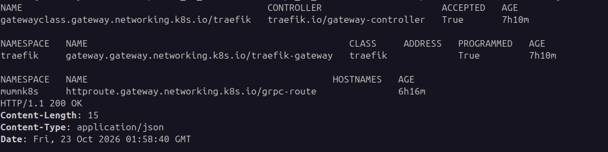
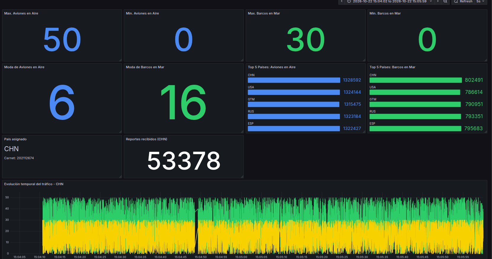
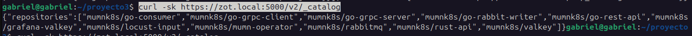
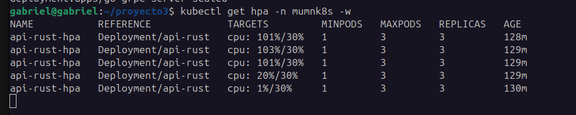
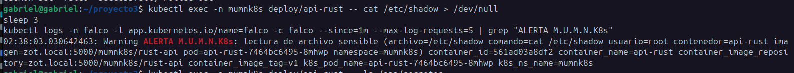
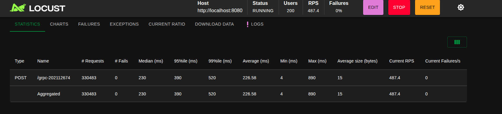

# Manual técnico y guía de instalación

**Monitoreo de Unidades Militares en la Nube con Kubernetes**
Sistemas Operativos 1 · Proyecto #3 · Universidad de San Carlos de Guatemala

| | |
|---|---|
| **Estudiante** | Alvaro Gabriel Ramirez Alvarez |
| **Carnet** | 202112674 |
| **País asignado**  | **CHN** |
| **Ruta del flujo gRPC** | `/grpc-202112674` |
| **Infraestructura** | Cluster forma local usé **kind** (Kubernetes dentro de contenedores Docker) y **Traefik** como implementación de Gateway API. |

---

## Índice

1. [Resumen](#1-resumen)
2. [Arquitectura general](#2-arquitectura-general)
3. [Infraestructura y entorno](#3-infraestructura-y-entorno)
4. [Flujo completo de datos](#4-flujo-completo-de-datos)
5. [Gateway API (Traefik)](#5-gateway-api-traefik)
6. [Comunicación REST y gRPC](#6-comunicación-rest-y-grpc)
7. [RabbitMQ y Consumer](#7-rabbitmq-y-consumer)
8. [Operator (Operator SDK, Helm-based): Valkey y Grafana](#8-operator-operator-sdk-helm-based-valkey-y-grafana)
9. [Grafana y dashboard](#9-grafana-y-dashboard)
10. [Zot y OCI Artifact](#10-zot-y-oci-artifact)
11. [HPA](#11-hpa)
12. [Falco: seguridad en tiempo real](#12-falco-seguridad-en-tiempo-real)
13. [Pruebas de carga y análisis de réplicas](#13-pruebas-de-carga-y-análisis-de-réplicas)
14. [Guía de instalación paso a paso](#14-guía-de-instalación-paso-a-paso)

---

## 1. Resumen

Se implementó un sistema distribuido que simula la recepción y el procesamiento de reportes militares generados en tiempo real por distintos países. Cada reporte contiene el país, la cantidad de aviones de guerra en el aire, la cantidad de barcos de guerra en el mar y una marca de tiempo:

```json
{
  "country": "CHN",
  "warplanes_in_air": 42,
  "warships_in_water": 14,
  "timestamp": "2026-10-22T20:15:30Z"
}
```

El sistema recibe el tráfico generado por **Locust**, lo expone con **Kubernetes Gateway API**, lo procesa en una **API REST en Rust** y en servicios **Go** que se comunican por **gRPC**, lo encola en **RabbitMQ**, lo consume y almacena en **Valkey**, y lo visualiza en **Grafana**. Valkey y Grafana no se instalan a mano: los despliega y reconcilia un **Operator de Kubernetes construido con Operator SDK (Helm-based)** a partir de dos Custom Resources (`ValkeyInstance` y `GrafanaInstance`). Todas las imágenes se publican y se consumen desde **Zot** (HTTPS, fuera del clúster). Adicionalmente se instaló **Falco** con una regla personalizada.

## 2. Arquitectura general


### Componentes

| Componente | Tecnología | Recurso en Kubernetes | Imagen (en Zot) |
|---|---|---|---|
| Generador de carga | Locust (Python) | Se ejecuta fuera del clúster | — |
| Exposición | Gateway API + Traefik | `GatewayClass`, `Gateway`, `HTTPRoute` | (chart oficial de Traefik) |
| API REST | Rust (axum, tokio, reqwest) | Deployment `api-rust` + HPA | `mumnk8s/rust-api:v1` |
| Go Deployment 1 | Go | Deployment `go-rest-api` (**2 containers**: `rest-api`, `grpc-client`) | `mumnk8s/go-rest-api:v1`, `mumnk8s/go-grpc-client:v1` |
| Go Deployment 2 | Go | Deployment `go-grpc-server` (**2 containers**: `grpc-server`, `rabbit-writer`) | `mumnk8s/go-grpc-server:v1`, `mumnk8s/go-rabbit-writer:v1` |
| Broker | RabbitMQ 3.13 | Deployment `rabbitmq` | `mumnk8s/rabbitmq:3.13-management` |
| Consumer | Go | Deployment `go-consumer` | `mumnk8s/go-consumer:v1` |
| Almacenamiento | Valkey 8 | StatefulSet `valkey` + Service + PVC (creados por el Operator) | `mumnk8s/valkey:8` |
| Visualización | Grafana 11.3 + plugin `redis-datasource` | Deployment `grafana` (creado por el Operator) | `mumnk8s/grafana-valkey:11.3.0` |
| Operator | Operator SDK (plugin Helm) | Deployment en `mumn-operator-system`, CRDs | `mumnk8s/mumn-operator:v2` |
| Seguridad | Falco (driver `modern_ebpf`) | DaemonSet en el namespace `falco` | (chart oficial de Falco) |
| Registry | Zot | Contenedor Docker fuera del clúster, con HTTPS | — |

Todo el sistema de aplicación vive en el namespace **`mumnk8s`**.

## 3. Infraestructura y entorno

Entorno real utilizado (obtenido con `kubectl get nodes -o wide`):

| Nodo | Rol | IP interna | Kernel | Runtime |
|---|---|---|---|---|
| `mumnk8s-control-plane` | control-plane | 172.18.0.3 | 7.0.0-38-generic | containerd 1.7.18 |
| `mumnk8s-worker` | worker | 172.18.0.2 | 7.0.0-38-generic | containerd 1.7.18 |

Kubernetes **v1.31.0**, creado con **kind** (clúster `mumnk8s`).

### Equivalencia con GKE

| Aspecto | GKE (enunciado) | Este proyecto (local) |
|---|---|---|
| Clúster | GKE con instancias N1 | kind: 1 control-plane + 1 worker (contenedores Docker) |
| Registry | Zot en una VM de GCP | Zot en un contenedor Docker del host, **fuera del clúster**, con HTTPS |
| Gateway API | Controlador del proveedor | Traefik |
| Acceso externo | IP pública | `localhost:8080` (`extraPortMappings` de kind → NodePort 30080 de Traefik) |
| Almacenamiento | PD de GCP | StorageClass `standard` de kind |

### Configuración de kind (`k8s/kind-config.yaml`)

```yaml
kind: Cluster
apiVersion: kind.x-k8s.io/v1alpha4
nodes:
  - role: control-plane
    extraPortMappings:
      - containerPort: 30080
        hostPort: 8080
        protocol: TCP
  - role: worker
containerdConfigPatches:
  - |-
    [plugins."io.containerd.grpc.v1.cri".registry.configs."zot.local:5000".tls]
      insecure_skip_verify = true
```

El parche de `containerd` permite que los nodos descarguen imágenes de Zot (certificado autofirmado). Además, el script `k8s/setup-hosts.sh` agrega `zot.local` al `/etc/hosts` de cada nodo apuntando a la IP del host en la red `kind`.

### Estado real del clúster

El estado completo (nodos, deployments, servicios, PVC, HPA, Gateway, CRDs, Operator, Falco y catálogo de Zot) está capturado en [`docs/evidencia/estado.txt`](evidencia/estado.txt).

## 4. Flujo completo de datos

1. **Locust** genera reportes JSON con valores aleatorios (aviones 0–50, barcos 0–30, países USA/RUS/CHN/ESP/GTM) y los envía por `HTTP POST` a `http://localhost:8080/grpc-202112674`.
2. **Traefik (Gateway API)** recibe la petición. Un `HTTPRoute` con prefijo `/grpc-202112674` la envía al Service `api-rust`.
3. La **API Rust** valida el JSON (país de 3 letras, timestamp no vacío) y lo reenvía por HTTP al Service `go-rest-api`.
4. En el pod `go-rest-api`, el container **`rest-api`** recibe el reporte y lo entrega al container **`grpc-client`** del mismo pod por `localhost:9000`.
5. El **`grpc-client`** convierte el JSON en un mensaje protobuf (`WarReportRequest`) y llama por **gRPC** a `SendReport` del Service headless `go-grpc-server`, repartiendo las llamadas entre réplicas (`round_robin`).
6. En el pod `go-grpc-server`, el container **`grpc-server`** recibe la llamada y entrega el mensaje al container **`rabbit-writer`** por `localhost:9001`.
7. El **`rabbit-writer`** publica el mensaje en la cola durable `war_reports` de **RabbitMQ**.
8. El **Consumer** lee la cola con acknowledgement manual y, con un script Lua atómico, actualiza las estadísticas en **Valkey**.
9. **Grafana** consulta Valkey y muestra el dashboard.

## 5. Gateway API (Traefik)

**Kubernetes Gateway API** en lugar de Ingress. Se utilizó Traefik como controlador.

### Instalación

```bash
# CRDs estándar de Gateway API (v1.6.1; server-side para reemplazar CRDs previos)
kubectl apply --server-side --force-conflicts \
  -f https://github.com/kubernetes-sigs/gateway-api/releases/download/v1.6.1/standard-install.yaml

helm repo add traefik https://traefik.github.io/charts && helm repo update
helm install traefik traefik/traefik -n traefik --create-namespace \
  --set providers.kubernetesGateway.enabled=true \
  --set service.type=NodePort \
  --set ports.web.nodePort=30080
```


### Recursos

El chart de Traefik crea la `GatewayClass` `traefik` y el `Gateway` `traefik-gateway` (namespace `traefik`). Como la ruta vive en otro namespace (`mumnk8s`), se permite que el listener acepte rutas de todos los namespaces:

```bash
kubectl patch gateway traefik-gateway -n traefik --type=json \
  -p '[{"op":"replace","path":"/spec/listeners/0/allowedRoutes","value":{"namespaces":{"from":"All"}}}]'
```

`HTTPRoute` (`k8s/manifests/40-httproute.yaml`):

```yaml
apiVersion: gateway.networking.k8s.io/v1
kind: HTTPRoute
metadata:
  name: grpc-route
  namespace: mumnk8s
spec:
  parentRefs:
    - name: traefik-gateway
      namespace: traefik
  rules:
    - matches:
        - path: {type: PathPrefix, value: /grpc-202112674}
      backendRefs:
        - {name: api-rust, port: 8000}
```

### Verificación

```bash
kubectl get gatewayclass,gateway,httproute -A
curl -i -X POST http://localhost:8080/grpc-202112674 \
  -H "Content-Type: application/json" \
  -d '{"country":"CHN","warplanes_in_air":42,"warships_in_water":14,"timestamp":"2026-10-22T20:15:30Z"}'
```

Resultado real: `GatewayClass traefik ACCEPTED=True`, `Gateway traefik-gateway PROGRAMMED=True`, `HTTPRoute grpc-route` creado, y la petición responde `HTTP/1.1 200 OK` con `{"status":"ok"}`.



**Diferencia con Ingress:** Gateway API separa responsabilidades en tres recursos: `GatewayClass` (qué controlador), `Gateway` (qué puertos y listeners expone la infraestructura) y `HTTPRoute` (qué rutas apuntan a qué Services). Permite que cada equipo gestione sus rutas en su propio namespace sin tocar la infraestructura de entrada.

## 6. Comunicación REST y gRPC

### API REST en Rust (`rust-api/`)

- Framework **axum** sobre **tokio** (asíncrono, multihilo), cliente HTTP **reqwest** con pool de conexiones reutilizadas.
- `POST /grpc-202112674`: valida el reporte y lo reenvía a `go-rest-api`. Responde `200` si el flujo aguas abajo respondió bien o `502` si falló.
- `GET /health`: usado por la `readinessProbe`.
- Imprime una línea por reporte (`[api-rust] recibido country=...`) para poder seguir el flujo con `kubectl logs -l app=api-rust`.

### Servicios en Go (`go/`)

Un único módulo Go con cuatro servicios; el mismo `Dockerfile` los construye con `--build-arg SERVICE=<nombre>`.

| Servicio | Pod | Función |
|---|---|---|
| `rest-api` | `go-rest-api` | Recibe HTTP de Rust y reenvía por `localhost` al `grpc-client` |
| `grpc-client` | `go-rest-api` | **Cliente gRPC**: llama a `SendReport` |
| `grpc-server` | `go-grpc-server` | **Servidor gRPC**: recibe `SendReport` y lo entrega al writer |
| `rabbit-writer` | `go-grpc-server` | Publica en RabbitMQ |

Cada Deployment tiene **2 containers** (como pide el enunciado) que se comunican por `localhost`, porque comparten el mismo namespace de red del pod.

### Contrato gRPC (`go/proto/war.proto`)

```proto
syntax = "proto3";
package wartweets;
option go_package = "mumnk8s/proto";

message WarReportRequest {
  Countries country = 1;
  int32 warplanes_in_air = 2;
  int32 warships_in_water = 3;
  string timestamp = 4;
}

enum Countries {
  countries_unknown = 0;
  usa = 1;
  rus = 2;
  chn = 3;
  esp = 4;
  gtm = 5;
}

message WarReportResponse { string status = 1; }

service WarReportService {
  rpc SendReport (WarReportRequest) returns (WarReportResponse);
}
```

El único cambio respecto a la propuesta del enunciado es `go_package = "mumnk8s/proto"` (en lugar de `"./proto"`), porque los paths relativos no son válidos para el generador. Código generado con:

```bash
cd go
protoc --go_out=. --go_opt=paths=source_relative \
       --go-grpc_out=. --go-grpc_opt=paths=source_relative proto/war.proto
```

### Manejo de concurrencia en Go

- **`rest-api`:** `net/http` atiende cada petición en su propia goroutine; el cliente HTTP reutiliza conexiones (`MaxIdleConnsPerHost: 200`).
- **`grpc-client`:** una única conexión gRPC (`grpc.ClientConn`) segura entre goroutines, con *timeout* por llamada vía `context`.
- **`grpc-server`:** el servidor gRPC atiende cada RPC en una goroutine.
- **`rabbit-writer`:** *pool de workers*. Un canal de Go con buffer (5000) recibe los mensajes y **8 goroutines** los publican, **cada una con su propio canal AMQP** (los canales AMQP no son seguros entre goroutines). Si el buffer se llena, responde `503` en lugar de bloquear.
- **`consumer`:** 8 workers leen del mismo canal AMQP con `Qos(prefetch=200)` y acknowledgement manual.

### Balanceo de carga gRPC entre réplicas

gRPC usa HTTP/2 con conexiones largas: con un Service `ClusterIP` normal, el cliente se pegaría a **un solo pod** y las réplicas extra no recibirían carga. Por eso el Service `go-grpc-server` es **headless** (`clusterIP: None`) y el cliente usa:

```go
grpc.NewClient("dns:///go-grpc-server:50051",
    grpc.WithTransportCredentials(insecure.NewCredentials()),
    grpc.WithDefaultServiceConfig(`{"loadBalancingConfig":[{"round_robin":{}}]}`))
```

DNS devuelve la IP de cada pod y `round_robin` reparte las llamadas. Se verificó con 2 réplicas: ambos pods mostraron carga y registros de reportes.

## 7. RabbitMQ y Consumer

- **Despliegue:** `k8s/manifests/10-rabbitmq.yaml` (Deployment, Service con puertos 5672 AMQP y 15672 management, y Secret con las credenciales).
- **Cola:** `war_reports`, **durable**; los mensajes se publican con `DeliveryMode: Persistent`.
- **Productor:** `rabbit-writer` (sección 6).
- **Consumidor:** Deployment `go-consumer` (`go/cmd/consumer`). Usa **ack manual**: si falla la escritura en Valkey, el mensaje se devuelve a la cola (`Nack` con requeue) y no se pierde. Mensajes con JSON inválido se descartan con log.

Verificación:

```bash
kubectl exec -n mumnk8s deploy/rabbitmq -- rabbitmqctl list_queues name messages
```

Resultado real durante las pruebas con el consumer activo: `war_reports 0` (la cola se vacía a la velocidad de producción).

### Modelo de datos en Valkey

El consumer ejecuta **un script Lua por reporte**. Valkey lo ejecuta de forma **atómica**, de modo que varias réplicas del consumer pueden escribir a la vez sin condiciones de carrera.

| Clave | Tipo | Contenido | Panel que alimenta |
|---|---|---|---|
| `stats:max_planes`, `stats:min_planes` | string | Máximo y mínimo general de aviones | Máx. y mín. de aviones |
| `stats:max_ships`, `stats:min_ships` | string | Máximo y mínimo general de barcos | Máx. y mín. de barcos |
| `freq:planes`, `freq:ships` | hash | valor → veces que apareció | (auxiliar de la moda) |
| `stats:mode_planes`, `stats:mode_ships` | string | Moda | Moda de aviones y de barcos |
| `totals:planes`, `totals:ships` | hash | país → suma acumulada | Top 5 de países |
| `reports:count` | hash | país → cantidad de reportes | Reportes del país asignado |
| `stream:<PAÍS>` | stream | entradas `planes`, `ships` | Serie temporal |

**Expiración y control de memoria** (recomendación del enunciado): cada stream tiene `MAXLEN ~ 10000` y `EXPIRE 86400` (24 h); los demás datos son acotados (un campo por país o por valor posible). Valkey corre con `maxmemory 256mb` y política `noeviction`, para que Valkey nunca descarte las estadísticas acumuladas.

## 8. Operator (Operator SDK, Helm-based): Valkey y Grafana

### Qué es y cómo funciona

Un **Operator** extiende Kubernetes con un nuevo tipo de recurso (CRD) y un controlador que lo reconcilia. Aquí se usó el **plugin Helm de Operator SDK**: el controlador es genérico y lo único que se escribe es (1) el CRD, (2) un **Helm chart** por tipo y (3) el archivo `watches.yaml` que los une.

```yaml
# operator/watches.yaml
- group: operators.mumnk8s.io
  version: v1alpha1
  kind: ValkeyInstance
  chart: helm-charts/valkeyinstance
- group: operators.mumnk8s.io
  version: v1alpha1
  kind: GrafanaInstance
  chart: helm-charts/grafanainstance
```

**Lógica de reconciliación:**

1. El usuario crea o modifica un Custom Resource (por ejemplo `ValkeyInstance`).
2. El Operator detecta el evento y toma el `spec` del CR como **valores del Helm chart**.
3. Ejecuta `helm install` (primera vez) o `helm upgrade` (cambios), usando el nombre del CR como nombre del release.
4. Periódicamente compara el estado deseado con el real y **corrige la deriva** (si alguien borra el StatefulSet a mano, el Operator lo vuelve a crear).
5. Al borrar el CR ejecuta `helm uninstall` y elimina los recursos hijos.

### Creación

```bash
mkdir operator && cd operator
operator-sdk init --plugins helm --domain mumnk8s.io --project-name mumn-operator
operator-sdk create api --group operators --version v1alpha1 --kind ValkeyInstance
operator-sdk create api --group operators --version v1alpha1 --kind GrafanaInstance
```

Los charts generados por defecto se reemplazaron por los de este proyecto en `operator/helm-charts/valkeyinstance` y `operator/helm-charts/grafanainstance` (el código fuente de referencia está también en `operator-overrides/`).

### CRDs

| CRD | Plural (para `kubectl get`) | Grupo / versión |
|---|---|---|
| `ValkeyInstance` | `valkeyinstances` | `operators.mumnk8s.io/v1alpha1` |
| `GrafanaInstance` | `grafanainstances` | `operators.mumnk8s.io/v1alpha1` |

### Chart de Valkey (`helm-charts/valkeyinstance`)

Genera tres recursos:

- **StatefulSet** `<nombre>` con el contenedor Valkey, `--appendonly yes` (persistencia AOF), `--maxmemory` y `--maxmemory-policy` tomados del CR, y sondas `valkey-cli ping`.
- **Service** `<nombre>` (puerto 6379), que es el que usa el Consumer (`valkey:6379`).
- **PersistentVolumeClaim** por `volumeClaimTemplates` (`data-valkey-0`, 1Gi), montado en `/data`, que garantiza la persistencia.

Custom Resource (`k8s/cr/valkey.yaml`):

```yaml
apiVersion: operators.mumnk8s.io/v1alpha1
kind: ValkeyInstance
metadata:
  name: valkey
  namespace: mumnk8s
spec:
  image: zot.local:5000/mumnk8s/valkey:8
  persistence:
    enabled: true
    size: 1Gi
  maxmemory: 256mb
  maxmemoryPolicy: noeviction
```

### Chart de Grafana (`helm-charts/grafanainstance`)

Genera: **Deployment**, **Service** (3000), **Secret** con el usuario/contraseña de administrador, un **ConfigMap con el datasource** de Valkey y un **ConfigMap con el dashboard** (`files/dashboard.json`) más su *provider*. Grafana arranca ya configurado, sin pasos manuales.

Custom Resource (`k8s/cr/grafana.yaml`):

```yaml
apiVersion: operators.mumnk8s.io/v1alpha1
kind: GrafanaInstance
metadata:
  name: grafana
  namespace: mumnk8s
spec:
  image: zot.local:5000/mumnk8s/grafana-valkey:11.3.0
  adminUser: admin
  adminPassword: admin123
  valkeyHost: valkey
  valkeyPort: 6379
```

### RBAC (`operator/config/rbac/role.yaml`)

Como el Operator crea recursos en nombre del CR, su `ClusterRole` permite gestionar `secrets` (donde Helm guarda sus releases), `configmaps`, `services`, `serviceaccounts`, `persistentvolumeclaims`, `pods`, `deployments`, `statefulsets` y los propios CRs. Sin esas reglas, la reconciliación falla con errores `forbidden`.

### Despliegue del Operator dentro del clúster

```bash
cd operator
make docker-build IMG=zot.local:5000/mumnk8s/mumn-operator:v2
make docker-push  IMG=zot.local:5000/mumnk8s/mumn-operator:v2
make deploy       IMG=zot.local:5000/mumnk8s/mumn-operator:v2
kubectl get pods -n mumn-operator-system
kubectl get crd | grep mumnk8s
```

El Operator corre como un Deployment en el namespace `mumn-operator-system` (**dentro del clúster**, no en una máquina virtual) y su imagen se descarga de Zot. El chart viaja dentro de la imagen del Operator, por lo que cualquier cambio en un chart requiere reconstruir y redesplegar la imagen con un nuevo tag.

### Evidencia real

```text
grafanainstances.operators.mumnk8s.io    2026-10-22T20:51:59Z
valkeyinstances.operators.mumnk8s.io     2026-10-22T20:28:43Z

valkeyinstance.operators.mumnk8s.io/valkey      102m
grafanainstance.operators.mumnk8s.io/grafana     79m

mumn-operator-controller-manager-...   1/1   Running
statefulset.apps/valkey   1/1      persistentvolumeclaim/data-valkey-0   Bound   1Gi
```

### Pruebas de reconciliación y persistencia

```bash
# 1. Persistencia: borrar el pod; el StatefulSet lo recrea y los datos siguen (AOF en el PVC)
kubectl delete pod valkey-0 -n mumnk8s
kubectl wait --for=condition=Ready pod/valkey-0 -n mumnk8s --timeout=120s
kubectl exec -n mumnk8s valkey-0 -- valkey-cli HGETALL reports:count

# 2. Reconciliación: borrar el StatefulSet a mano; el Operator lo recrea
kubectl delete statefulset valkey -n mumnk8s

# 3. Ciclo de vida declarativo: borrar el CR elimina los recursos hijos
kubectl delete -f k8s/cr/valkey.yaml     # (el PVC se conserva por protección de StatefulSet)
kubectl apply  -f k8s/cr/valkey.yaml
```

> Al borrar un `ValkeyInstance`, el **PVC no se elimina**: Kubernetes protege los volúmenes de los StatefulSets. Si se vuelve a crear el CR con el mismo nombre, Valkey recupera sus datos.

## 9. Grafana y dashboard

Acceso: `kubectl port-forward -n mumnk8s svc/grafana 3000:3000` y abrir `http://localhost:3000`.

**Fuente de datos.** Grafana usa el plugin **Redis Data Source** (preinstalado en la imagen propia `grafana-valkey`), compatible con Valkey porque este implementa el protocolo de Redis. El datasource `Valkey` (uid `valkey`) se provisiona desde el ConfigMap generado por el chart:

```yaml
datasources:
  - name: Valkey
    uid: valkey
    type: redis-datasource
    access: proxy
    url: redis://valkey:6379
    isDefault: true
```

**Dashboard "M.U.M.N.K8s MONITORING DASHBOARD"** (provisionado desde `files/dashboard.json`, con refresco cada 5 s). País asignado según el último dígito del carnet (4): **CHN**.

| Visualización requerida | Panel | Consulta (plugin Redis) |
|---|---|---|
| Máximo general de aviones | Stat | `GET stats:max_planes` |
| Mínimo general de aviones | Stat | `GET stats:min_planes` |
| Máximo general de barcos | Stat | `GET stats:max_ships` |
| Mínimo general de barcos | Stat | `GET stats:min_ships` |
| Moda de aviones | Stat | `GET stats:mode_planes` |
| Moda de barcos | Stat | `GET stats:mode_ships` |
| Top 5 países con más aviones | Bar gauge | `HGETALL totals:planes` (+ transformaciones: a número, ordenar, límite 5) |
| Top 5 países con más barcos | Bar gauge | `HGETALL totals:ships` (+ transformaciones) |
| Serie temporal del país asignado | Time series | `XRANGE stream:CHN - +` (aviones y barcos) |
| Nombre del país asignado | Text | `CHN` + carnet |
| Total de reportes del país asignado | Stat | `HGET reports:count CHN` |



Con 50 usuarios simultáneos de Locust el dashboard mostró, por ejemplo: máximo de aviones 50 y mínimo 0; máximo de barcos 30 y mínimo 0; **53 378 reportes de CHN**; y un total acumulado de ~1.33 millones de aviones para CHN (promedio de ~24.9 aviones por reporte, coherente con una distribución uniforme entre 0 y 50).

## 10. Zot y OCI Artifact

**Zot** es el registry OCI. Corre **fuera del clúster** (contenedor Docker del host), con **HTTPS** (certificado autofirmado) y almacenamiento persistente en `~/zot/data`.

```json
{
  "distSpecVersion": "1.1.0",
  "storage": { "rootDirectory": "/var/lib/registry" },
  "http": { "address": "0.0.0.0", "port": "5000",
            "tls": { "cert": "/certs/zot.crt", "key": "/certs/zot.key" } },
  "log": { "level": "info" }
}
```

Confianza en el certificado: Docker usa `/etc/docker/certs.d/zot.local:5000/ca.crt` y `containerd` de los nodos de kind usa `insecure_skip_verify` para ese registry (sección 3).

### Publicación y consumo de imágenes

Todas las imágenes de los microservicios se construyen localmente, se publican en Zot (`./scripts/build-push.sh`) y los manifiestos las descargan de ahí (`image: zot.local:5000/mumnk8s/...`). Imágenes públicas de terceros (RabbitMQ, Valkey) se **espejan** en Zot para que todos los pods consuman únicamente de este registry.

Catálogo real (`curl -sk https://zot.local:5000/v2/_catalog`):

```
mumnk8s/go-consumer      mumnk8s/go-grpc-client   mumnk8s/go-grpc-server
mumnk8s/go-rabbit-writer mumnk8s/go-rest-api      mumnk8s/grafana-valkey
mumnk8s/mumn-operator    mumnk8s/rabbitmq         mumnk8s/rust-api
mumnk8s/valkey           mumnk8s/locust-input     (OCI Artifact)
```



### OCI Artifact: archivo de entrada de Locust

Un **OCI Artifact** es cualquier archivo (no una imagen de contenedor) almacenado en un registry con el mismo formato y API. Se usa para distribuir el archivo de entrada de la prueba de carga: `locust/locust-input.json`, que define la ruta, los países y los rangos de aviones y barcos:

```json
{
  "route": "/grpc-202112674",
  "countries": ["USA", "RUS", "CHN", "ESP", "GTM"],
  "warplanes_in_air": {"min": 0, "max": 50},
  "warships_in_water": {"min": 0, "max": 30}
}
```

**Publicación** (herramienta `oras`, script `scripts/oci-artifact.sh push`):

```bash
oras push zot.local:5000/mumnk8s/locust-input:v1 --ca-file ~/zot/certs/zot.crt \
  --artifact-type application/vnd.mumnk8s.locust-input.v1+json \
  locust-input.json:application/json
```

**Descarga y uso** (`scripts/oci-artifact.sh pull`): descarga el archivo a `locust/input/locust-input.json`. El `locustfile.py` **lee ese archivo al iniciar** para construir cada reporte y se detiene con un mensaje claro si no existe, por lo que Locust depende del artifact descargado desde Zot.


## 11. HPA

HorizontalPodAutoscaler del Deployment de Rust (`k8s/manifests/30-rust-api.yaml`):

```yaml
apiVersion: autoscaling/v2
kind: HorizontalPodAutoscaler
metadata:
  name: api-rust-hpa
  namespace: mumnk8s
spec:
  scaleTargetRef: {apiVersion: apps/v1, kind: Deployment, name: api-rust}
  minReplicas: 1
  maxReplicas: 3
  metrics:
    - type: Resource
      resource:
        name: cpu
        target: {type: Utilization, averageUtilization: 30}
```

- **Rango:** 1 a 3 réplicas; **objetivo:** CPU promedio del 30%.
- El porcentaje se calcula sobre el `request` de CPU del contenedor (`100m`), por eso el pod de Rust escala con facilidad.
- Requiere **metrics-server**. En kind se instala con el parámetro `--kubelet-insecure-tls`, porque los kubelets usan certificados autofirmados.
- Todos los Deployments definen `requests` y `limits` (recomendación del enunciado de optimización del rendimiento).

### Resultado observado durante la prueba de carga

| Momento | `TARGETS` (CPU) | Réplicas |
|---|---|---|
| Bajo carga | 101 % / 30 % | **3** (máximo) |
| Bajo carga | 103 % / 30 % | 3 |
| Bajo carga | 101 % / 30 % | 3 |
| Al terminar la carga | 20 % / 30 % | 3 |
| Reposo | 1 % / 30 % | 3 → baja a 1 tras la ventana de estabilización |

Con la CPU al ~100 % frente a un objetivo del 30 %, el HPA llevó el Deployment de 1 a **3 réplicas** (`api-rust-...-6th62`, `-8b799` y `-8mhwp`). Al terminar la carga, la CPU cayó a 1 % y el HPA reduce las réplicas después de su ventana de estabilización (5 minutos por defecto), para evitar oscilaciones.



## 12. Falco: seguridad en tiempo real

**Falco** audita las llamadas al sistema (syscalls) de Linux desde el kernel y emite alertas según reglas. Se instaló con Helm usando el driver **`modern_ebpf`** (requiere kernel ≥ 5.8 y BTF; el equipo usa el kernel 7.0.0, y `/sys/kernel/btf/vmlinux` existe). Como kind comparte el kernel del host, Falco observa los contenedores de los nodos.

### Instalación

```bash
helm repo add falcosecurity https://falcosecurity.github.io/charts && helm repo update
helm install falco falcosecurity/falco -n falco --create-namespace \
  --set driver.kind=modern_ebpf \
  --set tty=true \
  --set-file 'customRules.mumnk8s-rules\.yaml=falco/mumnk8s-rules.yaml'
```

Resultado: un pod `falco` (2/2 `Running`) por cada nodo.

### Regla personalizada (`falco/mumnk8s-rules.yaml`)

```yaml
- rule: Lectura de archivo sensible en pods M.U.M.N.K8s
  desc: >
    Detecta la apertura o lectura de /etc/shadow o del directorio confidencial
    /app/secretos dentro de los pods de la API REST en Rust o de los servicios en Go.
  condition: >
    evt.type in (open, openat, openat2) and evt.dir = <
    and evt.is_open_read = true
    and container.id != host
    and (fd.name = /etc/shadow or fd.name startswith /app/secretos)
    and (container.image.repository contains "/rust-api" or container.image.repository contains "/go-")
  output: >
    ALERTA M.U.M.N.K8s: lectura de archivo sensible
    (archivo=%fd.name comando=%proc.cmdline usuario=%user.name
    contenedor=%container.name imagen=%container.image.repository
    pod=%k8s.pod.name namespace=%k8s.ns.name)
  priority: WARNING
  tags: [mumnk8s, filesystem, proyecto3]
```

**Cómo funciona.** La condición se cumple cuando: (1) el evento es una apertura de archivo en modo lectura (`open`, `openat`, `openat2`); (2) ocurre dentro de un contenedor y no en el host; (3) el archivo es `/etc/shadow` o cuelga de `/app/secretos`; y (4) el contenedor pertenece a las imágenes de Rust o de Go del proyecto. Los Dockerfiles de Rust y Go crean el directorio `/app/secretos` como carpeta confidencial de prueba.

### Simulación de la amenaza

```bash
kubectl exec -n mumnk8s deploy/api-rust -- ls /app/secretos
kubectl exec -n mumnk8s deploy/api-rust -- cat /etc/shadow
kubectl logs -n falco -l app.kubernetes.io/name=falco -c falco --tail=100 | grep ALERTA
```

### Alerta generada (log real de Falco)

```text
21:44:32.124761572: Warning ALERTA M.U.M.N.K8s: lectura de archivo sensible (archivo=/app/secretos comando=ls /app/secretos usuario=root contenedor=api-rust imagen=zot.local:5000/mumnk8s/rust-api pod=api-rust-7464bc6495-8mhwp namespace=mumnk8s)
```

La alerta identifica el archivo accedido, el comando ejecutado, el usuario, el contenedor, la imagen, el pod y el namespace, y se dispara en tiempo real en los logs de Falco.




## 13. Pruebas de carga y análisis de réplicas

### Metodología

- Herramienta: **Locust 2.x** en modo `--headless` (resultados en CSV/HTML), generando reportes con la estructura JSON del enunciado hacia `http://localhost:8080/grpc-202112674`.
- Carga base: **200 usuarios**, rampa de **20 usuarios/s**, duración **2 minutos** (`-u 200 -r 20 -t 2m`).
- Cada prueba parte de un sistema en reposo (cola de RabbitMQ en 0).
- **Importante:** todo corre en **una sola máquina** (Locust, los dos nodos de kind, Traefik, RabbitMQ, Valkey y Grafana comparten CPU y memoria). Los resultados son útiles para **comparar** configuraciones, no como capacidad absoluta de un clúster real.

### Resultados

| Prueba | Peticiones | Fallas | RPS | Latencia mediana | Latencia promedio | p95 | p99 | Máx. |
|---|---|---|---|---|---|---|---|---|
| Base (sin nombre, 2 min) | 56 701 | 0 | 475.9 | 270 ms | 278.5 ms | 430 ms | 520 ms | 653 ms |
| **Go Writers — 1 réplica** | 58 119 | 0 | **485.6** | 270 ms | **273.0 ms** | **390 ms** | 480 ms | 712 ms |
| **Go Writers — 2 réplicas** | 53 310 | 0 | **444.4** | 270 ms | **299.3 ms** | **530 ms** | 690 ms | 860 ms |
| Llenado de cola (1 min, consumer apagado) | 31 676 | 0 | 536.2 | 250 ms | 231.6 ms | 310 ms | 380 ms | 519 ms |

Archivos de origen: `docs/evidencia/writers_1replica_stats.csv`, `writers_2replicas_stats.csv`, `llenado_stats.csv` y `NOMBRE_stats.csv` (reporte HTML: `Prueba1.html`).



### Comparativa 1 vs 2 réplicas de los Go Writers

| Métrica | 1 réplica | 2 réplicas | Variación |
|---|---|---|---|
| RPS | 485.6 | 444.4 | **−8.5 %** |
| Latencia promedio | 273.0 ms | 299.3 ms | **+9.6 %** |
| Latencia p95 | 390 ms | 530 ms | **+35.9 %** |
| Fallas | 0 | 0 | sin cambio |

### Análisis

- **No hubo mejora al duplicar las réplicas; el rendimiento empeoró ligeramente** (~8.5 % menos RPS y mayor latencia en la cola de la distribución). Todas las peticiones terminaron sin fallas en ambos casos.
- **Interpretación (hipótesis).** Con ~480 RPS, el cuello de botella no parece estar en los Go Writers, que usan un pool de goroutines y apenas consumen CPU (en reposo los pods muestran ~1 m de CPU). El límite más probable está en la propia máquina: el generador Locust (Python, un solo proceso), Traefik, el Rust y los nodos de kind compiten por los mismos núcleos. Duplicar las réplicas **agrega** pods, conexiones HTTP/2 y planificación de CPU en ese mismo hardware, lo que explica una pequeña degradación en lugar de una mejora.
- **Dónde sí aporta escalar:** el balanceo se verificó funcionando: con 2 réplicas, ambos pods de `go-grpc-server` mostraron CPU y registros de reportes recibidos, gracias al Service headless y `round_robin`. En un entorno con más recursos por réplica (por ejemplo, nodos independientes en GKE) el reparto debería traducirse en mejoras.
- **Latencia:** la mediana se mantuvo en 270 ms en ambos casos; la diferencia está en los percentiles altos, es decir, en la variabilidad por competencia de CPU.
- **HPA:** bajo carga, el Deployment de Rust escaló a 3 réplicas con la CPU al ~101 % (sección 11), lo que confirma que la API Rust sí es el componente que más CPU consume, y que el autoescalado responde.

### Consumer y Valkey (cola llena vs. cola vaciándose)

**Metodología.** Con el consumer apagado (0 réplicas) se generó 1 minuto de carga con Locust (`-u 200 -r 20 -t 1m`) para acumular mensajes en `war_reports`. Luego se encendió el consumer con 1 y con 2 réplicas y se midió, con `scripts/medir-vaciado.sh`, el tiempo hasta que la cola llegó a 0. El script consulta la cola cada ~3 s; el tiempo incluye el arranque de los pods, igual en ambas pruebas.

| Consumer | Mensajes en cola al encender | Tiempo hasta cola = 0 | Velocidad promedio |
|---|---|---|---|
| 1 réplica | 29 575 | 30 s | **≈ 986 mensajes/s** |
| 2 réplicas | 33 021 | 15 s | **≈ 2 201 mensajes/s** |

Evolución de la cola (mensajes restantes):

```text
1 réplica :  3 s → 28 002 |  9 s → 21 869 | 14 s → 15 440 | 20 s → 8 979 | 25 s → 2 422 | 30 s → 0
2 réplicas:  4 s → 27 515 | 10 s → 10 629 | 15 s → 0
```

**Análisis.**

- Duplicar las réplicas del consumer **redujo el tiempo de vaciado de 30 s a 15 s (−50 %)**. Como las colas no tenían exactamente el mismo tamaño (la segunda tenía 11.6 % más mensajes), la comparación justa es la velocidad: pasó de ≈ 986 a ≈ 2 201 mensajes/s, es decir **2.2 veces más rápido** con 2 réplicas.
- El escalado es **casi lineal**. Que salga ligeramente por encima de 2× entra dentro del error de medición: el muestreo es cada ~3 s y el tiempo incluye el arranque de los pods.
- **Hipótesis:** el consumer está limitado por la CPU de cada pod (límite de `500m`). Parsear el JSON, ejecutar el script Lua en Valkey y confirmar el mensaje cuesta CPU, y cada réplica adicional suma otro presupuesto de CPU. No se midió la CPU del consumer durante esta prueba, por lo que esto no está comprobado.
- **Valkey no fue el cuello de botella en este rango:** absorbió más de 2 000 escrituras por segundo (cada una es un script Lua atómico) sin errores, y la cola llegó a 0 en ambas pruebas.
- **Contraste con los Go Writers** (sección anterior): allí duplicar las réplicas no mejoró el rendimiento, y aquí sí. El consumer hace más trabajo por mensaje que el writer (que solo encola), así que es la etapa donde escalar rinde. La conclusión es que conviene **medir para saber qué etapa limita** antes de escalar, y que escalar un componente que no es el cuello de botella no ayuda.

## 14. Guía de instalación paso a paso

Probado en **Ubuntu** (kernel 7.0.0), sin cuenta de GCP. Requisitos recomendados: **60 GB de disco libre, 16 GB de RAM (mínimo 8) y 4 CPU**.

### 14.1 Herramientas

```bash
sudo apt update && sudo apt install -y curl git build-essential ca-certificates gnupg jq openssl protobuf-compiler pipx
curl -fsSL https://get.docker.com | sudo sh && sudo usermod -aG docker $USER && newgrp docker
sudo snap install kubectl --classic && sudo snap install helm --classic && sudo snap install go --classic
sudo snap install oras --classic
curl -Lo ./kind https://kind.sigs.k8s.io/dl/v0.24.0/kind-linux-amd64 && chmod +x kind && sudo mv kind /usr/local/bin/
curl --proto '=https' --tlsv1.2 -sSf https://sh.rustup.rs | sh && source ~/.cargo/env
pipx install locust && pipx ensurepath
go install google.golang.org/protobuf/cmd/protoc-gen-go@latest
go install google.golang.org/grpc/cmd/protoc-gen-go-grpc@latest
echo 'export PATH=$PATH:$HOME/go/bin' >> ~/.bashrc && source ~/.bashrc
# operator-sdk: descargar el binario de https://github.com/operator-framework/operator-sdk/releases (p. ej. v1.37.0)
```

### 14.2 Zot (registry con HTTPS, fuera del clúster)

```bash
mkdir -p ~/zot/{certs,data} && cd ~/zot
openssl req -x509 -newkey rsa:4096 -nodes -days 365 -keyout certs/zot.key -out certs/zot.crt \
  -subj "/CN=zot.local" -addext "subjectAltName=DNS:zot.local,IP:172.17.0.1"
# crear config.json (ver sección 10)
docker run -d --name zot --restart always -p 5000:5000 \
  -v $PWD/config.json:/etc/zot/config.json -v $PWD/certs:/certs -v $PWD/data:/var/lib/registry \
  ghcr.io/project-zot/zot-linux-amd64:latest
echo "127.0.0.1 zot.local" | sudo tee -a /etc/hosts
sudo mkdir -p /etc/docker/certs.d/zot.local:5000 && sudo cp certs/zot.crt /etc/docker/certs.d/zot.local:5000/ca.crt
curl -k https://zot.local:5000/v2/_catalog
```

### 14.3 Clúster kind, hosts de los nodos y metrics-server

```bash
cd ~/proyecto3
kind create cluster --name mumnk8s --config k8s/kind-config.yaml
./k8s/setup-hosts.sh                       # agrega zot.local al /etc/hosts de cada nodo (repetir tras reiniciar)
kubectl apply -f https://github.com/kubernetes-sigs/metrics-server/releases/latest/download/components.yaml
kubectl patch -n kube-system deployment metrics-server --type=json \
  -p '[{"op":"add","path":"/spec/template/spec/containers/0/args/-","value":"--kubelet-insecure-tls"}]'
```

### 14.4 Gateway API con Traefik

Ver comandos de la [sección 5](#5-gateway-api-traefik). Comprobar `kubectl get gatewayclass,gateway -A` (ambos en `True`).

### 14.5 Imágenes de los servicios

```bash
cd ~/proyecto3/go
protoc --go_out=. --go_opt=paths=source_relative --go-grpc_out=. --go-grpc_opt=paths=source_relative proto/war.proto
go mod tidy && cd ..
./scripts/build-push.sh        # RabbitMQ (espejo), 4 servicios Go, Rust
./scripts/build-phase3.sh      # consumer y Valkey (espejo)
./scripts/build-phase4.sh      # Grafana con plugin
```

> Si `go mod tidy` sube la versión mínima de Go, la imagen base del `Dockerfile` (`golang:X.Y-alpine`) debe ser igual o más nueva.

### 14.6 Operator y Custom Resources

```bash
cd ~/proyecto3/operator
make docker-build docker-push deploy IMG=zot.local:5000/mumnk8s/mumn-operator:v2
kubectl get pods -n mumn-operator-system && kubectl get crd | grep mumnk8s
cd ..
kubectl apply -f k8s/manifests/00-namespace.yaml
kubectl apply -f k8s/cr/valkey.yaml
kubectl apply -f k8s/cr/grafana.yaml
```

### 14.7 Aplicación

```bash
kubectl patch gateway traefik-gateway -n traefik --type=json \
  -p '[{"op":"replace","path":"/spec/listeners/0/allowedRoutes","value":{"namespaces":{"from":"All"}}}]'
kubectl apply -f k8s/manifests/
kubectl get pods -n mumnk8s
```

### 14.8 Falco

Ver comandos de la [sección 12](#12-falco-seguridad-en-tiempo-real).

### 14.9 Verificación final

```bash
curl -i -X POST http://localhost:8080/grpc-202112674 -H "Content-Type: application/json" \
  -d '{"country":"CHN","warplanes_in_air":42,"warships_in_water":14,"timestamp":"2026-10-22T20:15:30Z"}'
kubectl exec -n mumnk8s deploy/rabbitmq -- rabbitmqctl list_queues name messages
kubectl exec -n mumnk8s valkey-0 -- valkey-cli HGETALL reports:count
./scripts/oci-artifact.sh pull
locust -f locust/locustfile.py --host http://localhost:8080
kubectl port-forward -n mumnk8s svc/grafana 3000:3000        # http://localhost:3000 (admin / admin123)
```

